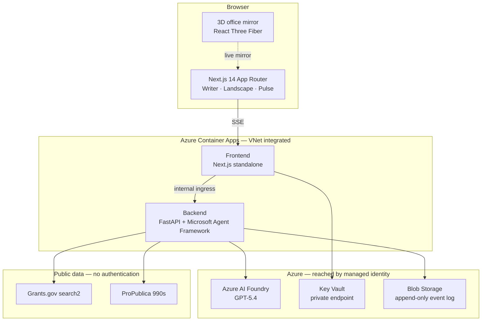

# Smart Grant Request

**Submission-ready grant applications for K-12 schools, grounded in federal data.**

[](https://github.com/microsoft/smart-grant/actions/workflows/ci.yml)
[](https://github.com/microsoft/smart-grant/actions/workflows/codeql.yml)
[](LICENSE)

A discovery agent ranks live Grants.gov opportunities against a real school — one of
**102,178 NCES records** — and then stops. A human chooses which to pursue. Five more
agents draft the application against that choice: narrative, budget, compliance,
intelligence, and writing. The result exports as a 20-page PDF.

Built on the **Microsoft Agent Framework** with **GPT-5.4** on **Azure AI Foundry**.

---

## There are no API keys to obtain

Every external data source this project reads is a public API with no authentication:

| Service | Purpose | Key required |
| --- | --- | --- |
| [Grants.gov `search2`](https://www.grants.gov/api/api-guide) | Live federal funding opportunities | **None** |
| [ProPublica Nonprofit Explorer](https://projects.propublica.org/nonprofits/api) | IRS Form 990 data for foundation prospects | **None** |
| NCES Common Core of Data | The 102,178-school index, built by `scripts/build-school-index.mjs` | **None** |
| **Azure AI Foundry** (or Azure OpenAI) | The models | **None — Entra ID** |

The only thing you must supply is **your own Azure subscription**. Even the model calls
authenticate with a managed identity rather than a key, so there is no secret to rotate,
to leak, or to accidentally commit.

Two optional integrations exist and stay off unless configured: a GSA Search.gov key for
a fallback search path, and an OpenTelemetry endpoint for traces.

---

## Architecture



The two applications talk over the environment's internal ingress; the backend is never
exposed publicly. Every Azure dependency is reached by **managed identity**, and the Key
Vault and storage account sit behind **private endpoints**. No connection string,
registry password, or API key exists anywhere in the running system.

---

## How the agents work

The pipeline deliberately **stops in the middle** and asks a human to choose.

1. **Discovery** ranks live opportunities against the school on an explicit 100-point
   rubric across eight dimensions — and disqualifies before it ranks. Candidates failing
   a hard eligibility check are listed with a one-line reason rather than silently
   dropped. If nothing qualifies it says so, and falls back to foundation prospects
   scored deterministically from IRS Form 990 filings.
2. **A person picks one.** No application is written against a guess.
3. **Narrative → Budget → Compliance → Intelligence → Writer** draft the submission
   against that choice, streaming token by token.

`/v2/office` mirrors the run as a 3D scene: the camera follows whoever is working, and
the text on the monitor is the real model output, not a simulation.

---

## Quick start

**Prerequisites:** Node.js 20+, Python 3.11, an Azure AI Foundry or Azure OpenAI
resource, and `az login` with access to it.

```bash
git clone https://github.com/microsoft/smart-grant.git
cd smart-grant

# Frontend
npm install

# Backend — requirements-dev.txt brings pytest and ruff, which production does not carry
cd agent_framework_backend
python -m venv .venv
. .venv/Scripts/Activate.ps1          # Windows PowerShell
# source .venv/bin/activate           # macOS / Linux
pip install -r requirements.txt -r requirements-dev.txt
cd ..

cp .env.example .env.local            # then set FOUNDRY_ENDPOINT
npm run dev
```

Frontend on `http://localhost:3000`, backend on `http://localhost:8000`.

To confirm the orchestrator is the real SDK and not a stub, this endpoint reflects the
installed package version and the fully-qualified class names straight from the running
process:

```bash
curl http://localhost:8000/v2/health
```

---

## Deploy to Azure

Infrastructure is declared in `infra/*.bicep` and applied in four steps. There are no
deployment scripts, deliberately: a script that drifts from the templates is worse than
no script at all.

```bash
RG=rg-smart-grant
az group create -n $RG -l eastus2

# 1. Network, Key Vault, storage, and the managed identities — including the
#    deploy identity and its GitHub federated credential.
az deployment group create -g $RG --template-file infra/foundation.bicep \
  --parameters githubRepository=<owner>/<repo>

# 2. Seed the interface credentials through the ARM control plane, which is not
#    subject to the vault's data-plane firewall.
az deployment group create -g $RG --template-file infra/secrets.bicep \
  --parameters vaultName=<from step 1> authSecret=<generated> authPassword=<yours>

# 3. The Container Apps environment and the two applications.
az deployment group create -g $RG --template-file infra/apps.bicep \
  --parameters sharedResourceGroupName=<rg holding ACR and Foundry> \
               acrLoginServer=<name>.azurecr.io \
               logAnalyticsWorkspaceName=<workspace> \
               openAiEndpoint=https://<account>.cognitiveservices.azure.com/ \
               imageTag=<git sha>

# 4. Least-privilege role assignments for every identity.
az deployment group create -g $RG --template-file infra/rbac.bicep
```

Every parameter is declared with a description, and the ones you have to look up include
the `az` command that produces them. `az bicep build --file infra/apps.bicep` lists them
all.

### What the templates give you by default

- **VNet-integrated Container Apps**, backend on internal ingress only
- **Key Vault with public network access disabled**, reached through a private endpoint
- **Managed identity everywhere** — image pulls, model calls, storage, secrets
- **Federated (OIDC) deployment** — the pipeline stores no password, and its token is
  pinned by subject to one repository and one branch
- **Least privilege** — the deploy identity holds `Container Apps Contributor` on the two
  apps and `AcrPush` on the registry, and nothing else

### CI/CD

`ci.yml` runs lint, tests and a Docker build on every push and pull request. `deploy.yml`
builds, pushes and swaps both images, then verifies: it polls each revision until it is
genuinely running and checks the live URL before reporting success.

Deployment needs three repository **secrets** (`AZURE_CLIENT_ID`, `AZURE_TENANT_ID`,
`AZURE_SUBSCRIPTION_ID`) and four repository **variables** (`ACR_LOGIN_SERVER`,
`RESOURCE_GROUP`, `BACKEND_APP`, `FRONTEND_APP`). Those secrets are identifiers, not
credentials — alone they authenticate no one. What grants access is the federated
credential declared in `infra/foundation.bicep`.

> **If federated login fails with no useful error, check the subject claim first.**
> Most repositories emit `repo:<owner>/<name>:ref:refs/heads/<branch>`, which is what
> `foundation.bicep` builds by default. Organizations with *immutable OIDC subjects*
> enabled emit numeric IDs instead — `repo:<owner>@<orgId>/<name>@<repoId>:ref:...` —
> and a credential registered in the conventional format simply never matches. Read the
> real value and pass it to `githubSubjectPrefix`:
>
> ```bash
> gh api repos/<owner>/<name>/actions/oidc/customization/sub
> ```

---

## Testing

```bash
# Backend
cd agent_framework_backend
ruff check .
pytest -q

# Frontend
npm run lint
npx tsc --noEmit
npm run build
```

The Pulse integration tests pin the storage SDK contract — append semantics, the
create-race guard, and a 404 read returning empty. Without the Azurite emulator running
they skip with an explicit reason rather than passing silently.

---

## Project structure

```
src/                       Next.js App Router, components, services
  app/v2/                  The product surface (Writer, Landscape, Pulse, Office)
  components/v2/office3d/  React Three Fiber scene mirroring the live run
agent_framework_backend/
  v2/                      Agents, workflows, prompts, schemas, providers
  services/                Grants.gov, foundations, analytics, Pulse event log
  tools/                   One-off maintenance utilities
infra/                     Bicep: foundation, apps, rbac, secrets
docs/                      Architecture, deployment, design system, agent framework
scripts/                   School index builder, dev runner
```

---

## Data sources and attribution

- **School data** is the U.S. Department of Education's National Center for Education
  Statistics (NCES) **Common Core of Data**, accessed through the **Urban Institute
  Education Data Portal**, which harmonises the federal releases into a single API.
  `scripts/build-school-index.mjs` queries that portal and writes
  `data/schools-index.json` — 102,178 schools, CCD year 2024.

  > Common Core of Data school directory (2024), Education Data Portal (Version 0.26.0),
  > Urban Institute, accessed July 31, 2026,
  > <https://educationdata.urban.org/documentation/>, made available under the
  > [ODC Attribution License](https://opendatacommons.org/licenses/by/1-0/).

  That index is a **point-in-time snapshot**, committed deliberately so a clone builds and
  runs with no network call and every commit resolves to the same 102,178 rows. Re-run the
  script to refresh it; the file records its own `source`, `endpoint`, `year` and `builtAt`.

- **Funding opportunities** come from Grants.gov, operated by the U.S. Department of
  Health and Human Services.
- **Foundation financials** come from ProPublica's Nonprofit Explorer, derived from IRS
  Form 990 filings.

Figures shown in the interface are computed from the filings and are a prioritisation aid,
not a guarantee. See [NOTICE.md](NOTICE.md) for the full third-party notice.

---

## Contributing

Pull requests are welcome — see [CONTRIBUTING.md](CONTRIBUTING.md) for setup, branching,
commit style, and the review bar.

This project has adopted the
[Microsoft Open Source Code of Conduct](https://opensource.microsoft.com/codeofconduct/).
For more information see the
[Code of Conduct FAQ](https://opensource.microsoft.com/codeofconduct/faq/) or contact
[opencode@microsoft.com](mailto:opencode@microsoft.com) with any additional questions or
comments.

Most contributions require you to agree to a Contributor License Agreement (CLA). Visit
<https://cla.opensource.microsoft.com> for details.

Security issues must never be filed as public issues — see [SECURITY.md](SECURITY.md).

---

## Project status

This repository is a **reference implementation**, classified as **non-production** under
Microsoft's 1ES engineering policy. It publishes no signed or packaged artifacts, requires
no internal Microsoft tooling to build or run, and is not a dependency of any Microsoft
product or service.

You are welcome to deploy it, learn from it, and fork it. If you intend to run it in a
production scenario, you would need to either work with the maintainers to upgrade its
classification, or fork it, list yourself as the owner of that fork, classify the fork as
production, and complete the compliance tasks your organization requires.

---

## Trademarks

This project may contain trademarks or logos for projects, products, or services.
Authorized use of Microsoft trademarks or logos is subject to and must follow
[Microsoft's Trademark & Brand Guidelines](https://www.microsoft.com/legal/intellectualproperty/trademarks/usage/general).
Use of Microsoft trademarks or logos in modified versions of this project must not cause
confusion or imply Microsoft sponsorship. Any use of third-party trademarks or logos is
subject to those third-parties' policies.

---

## License

The **code** is MIT — see [LICENSE](LICENSE).

`data/schools-index.json` is **not** covered by that licence. It is a copy of the Urban
Institute Education Data Portal database and remains under the
[ODC Attribution License v1.0](https://opendatacommons.org/licenses/by/1-0/), which permits
redistribution with attribution and imposes no share-alike condition. Details in
[NOTICE.md](NOTICE.md).
