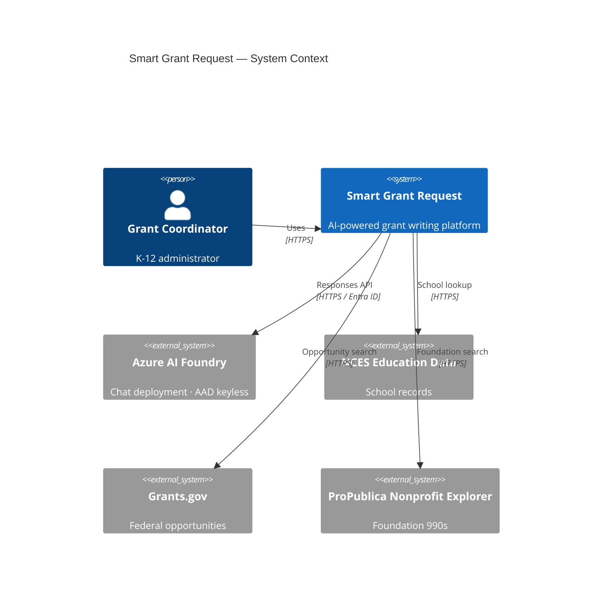
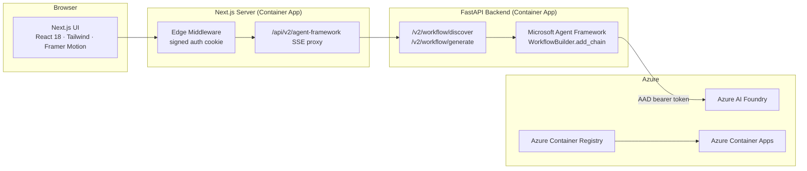

# Architecture

> A high-level system view of Smart Grant Request **v2**.
>
> This is a living document. Update it when adding components, changing the
> request flow, or introducing new external dependencies.

---

## 1. System context

Smart Grant Request is a two-tier application: a **Next.js 14 frontend** that
streams server-sent events from a **FastAPI backend** orchestrating the
**Microsoft Agent Framework SDK 1.3.0**. External services are Azure AI
Foundry, the NCES Common Core of Data (via the Urban Institute Education Data
Portal), Grants.gov, and the ProPublica Nonprofit Explorer.



---

## 2. Containers



---

## 3. The orchestrator

The backend uses the **Microsoft Agent Framework Python SDK 1.3.0** as the
real orchestration engine. Specifically:

| Symbol | Used for |
|---|---|
| `agent_framework.Agent` | Each of the six agents (Discovery, Narrative, Budget, Compliance, Intelligence, Writer). |
| `agent_framework.WorkflowBuilder.add_chain([...]).build()` | Composes each stage's chain. |
| `agent_framework.Executor` + `@handler` | Custom executors wrap each `Agent` to manage prompt building, streaming, and event emission. |
| `agent_framework.WorkflowContext.add_event / send_message / yield_output` | Used by executors to emit per-token deltas and complete events. |
| `agent_framework.Workflow.run(message, stream=True, include_status_events=False)` | Drives the live SSE stream. |
| `agent_framework_openai.OpenAIChatClient` | Each `Agent`'s LLM client, wrapped around an `AsyncAzureOpenAI` we construct ourselves with an AAD token provider. |

A defense-in-depth proof block is exposed on `GET /v2/health`:

```json
"workflow_engine": {
  "package": "agent_framework",
  "version": "1.3.0",
  "agent_class":       "agent_framework._agents.Agent",
  "workflow_class":    "agent_framework._workflows._workflow.Workflow",
  "builder_class":     "agent_framework._workflows._workflow_builder.WorkflowBuilder",
  "executor_class":    "agent_framework._workflows._executor.Executor",
  "chat_client_class": "agent_framework_openai._chat_client.OpenAIChatClient"
}
```

These symbols are printed reflectively from the running process — they cannot
be faked by a stub.

---

## 4. Request flow — rank, choose, write

The flow is deliberately **interrupted in the middle**. Discovery does not
hand its ranking to the writer; it hands it to the user.

### Stage 1 — discovery

1. User selects a school (live NCES search) and a grant purpose on `/v2`.
2. Frontend `POST /api/v2/agent-framework?stage=discover` → Next.js proxy.
3. Proxy `POST /v2/workflow/discover` → FastAPI (SSE).
4. FastAPI fetches live opportunities from Grants.gov and, for the foundation
   track, foundation 990s from the ProPublica Nonprofit Explorer.
5. `DiscoveryWorkflow` runs a single agent that scores each opportunity on an
   8-point rubric and returns a ranked list as structured JSON.
6. The stream ends. **Nothing has been written.**

### The human decision

7. The user picks one target: a federal opportunity, or a foundation.

### Stage 2 — generation

8. Frontend `POST /api/v2/agent-framework?stage=generate` carrying exactly one
   of `selectedGrant` or `selectedFoundation`. The proxy and the backend both
   reject a request that carries neither or both.
9. `GenerationWorkflow` chains five executors — Narrative, Budget, Compliance,
   Intelligence, Writer — with agent indices offset by 1 so the UI timeline
   lines up with Discovery in slot 0.
10. Each executor:
    - Receives a typed `AgentContext` payload (no global state).
    - Builds the agent's user prompt.
    - Calls `agent.run(user_prompt, stream=True)`.
    - Emits per-token `WorkflowEvent`s through `WorkflowContext.add_event(...)`.
11. The SSE proxy forwards events to the browser unbuffered.
12. On completion the frontend builds the PDF client-side with jsPDF
    (see [design-system.md](design-system.md) §10).

---

## 5. Data stores

| Store | Purpose | Lifetime |
|---|---|---|
| Browser localStorage | Last-used school, draft persistence | Per device |
| Signed auth cookie | Session | 24 h |
| Azure Blob Storage, container `pulse` | Pulse event log: one append blob per day, `YYYY/MM/DD.jsonl` | Permanent |
| `data/schools-index.json` | 102,178 NCES rows, all of them findable by the picker; 1,068 are flagged closed | Versioned in the repo |

Pulse used to write a SQLite file on the container's ephemeral disk, which
meant the history was lost on every restart and never shared between
replicas. It now appends to a blob per day. Append blobs make each write
atomic at the block level, so replicas can write concurrently without a
lock, and reading a period is a prefix listing rather than a full scan.

Access is Entra ID only — the account is provisioned with
`allowSharedKeyAccess: false`, public network access disabled, and reached
over a private endpoint. Pulse remains a nice-to-have activity panel, never
application logic: every write is fail-soft and cannot block a workflow, and
with no storage account configured the panel says it is not recording rather
than showing invented numbers.

---

## 6. Cross-cutting concerns

- **Auth (frontend).** Edge middleware validates a signed cookie; sign-in via
  `/api/auth/login` with `AUTH_USERNAME` / `AUTH_PASSWORD`.
- **Auth (backend → Foundry).** `DefaultAzureCredential` →
  `get_bearer_token_provider(cred, "https://cognitiveservices.azure.com/.default")`
  → `AsyncAzureOpenAI(azure_ad_token_provider=...)`. Keyless. Works on
  Foundry resources where API-key auth is disabled.
- **Observability.** OpenTelemetry spans per agent execution, exported to
  OTLP via `OTEL_EXPORTER_OTLP_ENDPOINT`.
- **Secrets.** Entra ID via `DefaultAzureCredential` everywhere possible.
  When keys are unavoidable, Azure Key Vault → Container Apps secrets.
- **Rate limiting.** Per-IP token bucket on the workflow routes (planned).

---

## 7. Open questions / future work

- Move from sequential to **partially parallel** agent execution (Discovery
  and Intelligence research can fan out).
- Add a **human-in-the-loop** approval node before the Writer agent.
- Add a **vector store** (Azure AI Search) for grant boilerplate retrieval.
- Surface per-agent observability (tokens / latency / cost) directly in the
  v2 UI.
