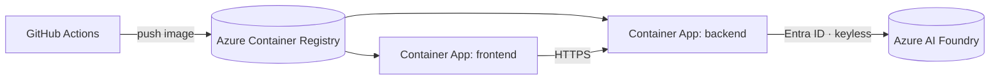

# Deployment

> Local Docker, Azure Container Apps, and one-click "Deploy to Azure".

---

## 1. Local development (two terminals)

```bash
# Terminal 1 — backend
cd agent_framework_backend
.\.venv\Scripts\python.exe -m uvicorn main:app --port 8000

# Terminal 2 — frontend
npm run dev:frontend
```

Open <http://localhost:3000/v2> (or 3001 if 3000 is in use).

Prerequisites:

- **Node.js 20+** and **npm 10+**.
- **Python 3.11+** with the venv at `agent_framework_backend/.venv`.
- An **Azure AI Foundry** project with a **GPT-5.4** deployment.
- **Azure CLI** signed in:
  ```bash
  az login --scope https://cognitiveservices.azure.com/.default
  ```

Required env vars in `.env.local`:

```bash
FOUNDRY_ENDPOINT=https://<project>.cognitiveservices.azure.com/
FOUNDRY_DEPLOYMENT_GPT_5_4=gpt-5.4
FOUNDRY_API_VERSION=2025-03-01-preview    # required for the Responses API
FOUNDRY_USE_AAD=true                      # use DefaultAzureCredential
AUTH_USERNAME=admin
AUTH_PASSWORD=<your-pass>
AUTH_SECRET=<random-hex>
```

---

## 2. Local — Docker Compose

```bash
docker compose up --build
```

Services:

| Service | Port | Image source |
|---|---|---|
| `frontend` | 3000 | `Dockerfile` (root) |
| `backend`  | 8000 | `agent_framework_backend/Dockerfile` |

Environment is read from `.env.local` at the repo root and passed through.

---

## 3. Azure Container Apps (current production topology)

Two Container Apps in one Container Apps Environment, one Container
Registry, and one Azure AI Foundry resource with a chat deployment.



### Recommended resource SKUs

| Resource | SKU |
|---|---|
| Container Apps Env | Consumption + Dedicated D4 workload profile |
| Frontend app | 0.5 vCPU / 1 GiB, min 1 / max 5 replicas |
| Backend app | 1.0 vCPU / 2 GiB, min 1 / max 10 replicas |
| Azure AI Foundry | Chat deployment, AAD (keyless) |

### Identity & auth

- The backend Container App runs with a **system-assigned managed identity**.
- That identity is granted **Cognitive Services User** on the Foundry
  project.
- `DefaultAzureCredential` picks up the managed identity automatically; no
  client secrets, no API keys.

---

## 4. CI/CD

[.github/workflows/ci.yml](../.github/workflows/ci.yml) runs on every push and
PR:

1. Lint + type-check + build (frontend)
2. Lint + tests (backend)
3. Smoke Docker build of both images

A separate `deploy.yml` (planned) will:

1. Build & push images to ACR (OIDC, no secrets).
2. `az containerapp update --image …` for each app.
3. Smoke-test the live URL, including `GET /v2/health` and asserting the
   `workflow_engine.package == "agent_framework"`.

---

## 5. One-click Deploy to Azure (planned)

The topology is already described in `infra/*.bicep` — `foundation.bicep` for
network, vault, storage and identities, `apps.bicep` for the environment and
the two applications, `rbac*.bicep` for the role assignments, and
`secrets.bicep` for seeding. What is still missing is the **Deploy to Azure**
button in the README, parameterised by subscription, region and resource
group.

---

## 6. Manual scripts

There are none, deliberately.

`deploy-azure.ps1`, `deploy-azure.sh` and `deploy/Deploy-SmartGrantRequest.ps1`
were removed. All three predated this topology and none of them could produce
it. The first two hardcoded a different subscription, built their own registry
with the admin user enabled, and passed the interface credentials to
`az containerapp create` as plain environment variables — no VNet, no private
endpoint, no Key Vault, no managed identity. The third created a Key Vault of
its own and wrote secrets through the data plane, which the tenant policy
blocks, and stored an Azure OpenAI API key that cannot exist because the
Foundry account has local authentication disabled.

Running any of them would not have updated production. It would have built a
second, weaker copy of it somewhere else — which is exactly what had already
happened once, and cost a month of confusion over which URL was real. An
escape hatch that quietly downgrades the security model is worse than no
escape hatch, so they live in the git history and not in the tree.

Deployment is CI. Infrastructure is `infra/*.bicep`.

---

## 7. Smoke test after deploy

```bash
curl https://<backend-fqdn>/v2/health | python -m json.tool
```

Expect:

- `"status": "healthy"`
- `"foundry_endpoint_configured": true`
- `"workflow_engine.package": "agent_framework"`
- `"workflow_engine.version": "1.3.0"` (or later)

If `workflow_engine` is missing or contains an `error`, the SDK failed to
import — check the backend logs and the resource's RBAC.
